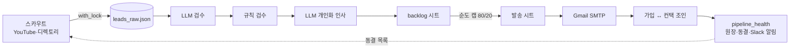

# B2B 파트너 모집 자동화 파이프라인

SaaS 레퍼럴 파트너 모집용 콜드 아웃리치를 **발굴 → 검수 → 개인화 → 발송 → 전환 추적**까지 사람 손 없이 매일 돌리는 파이프라인입니다.
Python 스크래퍼, Claude(LLM) 서브에이전트, Google Sheets, Gmail SMTP, cron으로 구성했고, 혼자 설계하고 운영했습니다.

> 실제 운영 코드에서 핵심 모듈만 골라 정리한 공개용 사본입니다.
> 회사명과 제품명은 가명(`Acme`)으로 바꿨고, 리드 데이터, 계정, 내부 성과 수치, 마케팅 카피는 뺐습니다.

## 이 프로젝트에서 한 일

**1. KPI를 수량에서 순도로 바꿨습니다**
처음 목표는 "하루 N건 수집"이었습니다. 그런데 발굴하기 쉬운 채널로 머릿수가 채워지면서, 한 달 발송의 대부분이 역대 가입 0인 채널로 쏠렸고 모집이 멈췄습니다.
발송 이력과 가입 데이터를 조인해서 채널별 전환을 측정했습니다. 그 결과 전환이 나오는 건 "플랫폼 디렉토리에 등재된 사람"뿐이라는 걸 확인했습니다.
그래서 KPI를 **"발송의 80% 이상을 전환 검증 채널로 채운다"**로 바꿨습니다. 사람이 지키는 규칙이 아니라 코드로 상한을 걸었습니다(`TIER2_MAX_RATIO`).

**2. 죽은 채널을 통계로 자동 동결했습니다**
기준 전환율이 약 1%인 채널이 300건을 보내고도 가입이 0일 확률은 5% 미만입니다. 이 조건을 만족하면 자동으로 동결해서, 매일 돌던 스카우트를 **약 75% 줄였습니다.**

**3. 사고가 날 때마다 회귀 테스트로 박제했습니다**
동시 쓰기로 인한 데이터 유실, 조용한 대량 격리, 대리지표로 내린 오진 같은 실제 사고 19종을 `selftest_pipeline.py`에 남겼습니다. 같은 실수는 다시 통과하지 못합니다.

**4. LLM 에이전트 비용을 절반으로 줄였습니다**
서브에이전트를 띄우는 비용을 실측했더니 절반이 쓰지도 않는 도구 정의였습니다. 에이전트마다 필요한 도구만 명시해서 기동 토큰을 **약 53% 줄였습니다.** 그 과정에서 전역 설정의 옛 복사본이 프로젝트 정의를 가리던 silent 버그도 찾아 고쳤습니다.

## 구조



| 단계 | 파일 | 포인트 |
|---|---|---|
| 동시성 | `with_lock.py` | 모든 스크래퍼를 flock 아래에서 순차 실행합니다. 동시 쓰기로 리드가 유실된 사고 이후 도입했습니다. |
| 판정 | `lead_dedup.py` | "새 리드인가"와 "보낼 수 있나"를 단 한 곳에서만 판정합니다. |
| 수집 | `youtube_api_scraper.py`, `imweb_expert_scraper.py`, `naver_fetch.py` | API 쿼터를 우회하고, 403 rate-limit에는 pacing과 backoff로 대응합니다. |
| 검수 | `llm_validator_batch.py`, `qualify_pending.py` | LLM이 먼저, 규칙이 나중입니다(순서 고정). 판정할 수 없으면 상태를 바꾸지 않고 멈춥니다. |
| 개인화 | `finalize_backlog.py`, `claude_cli.py` | 경량 CLI 호출로 건당 토큰을 줄이고, 금지어 필터로 본문과 겹치는 내용을 막습니다. |
| 발송 | `pull_from_backlog.py`, `send_from_sheet.py` | 순도 게이트를 지키고, 죽은 도메인을 사전에 차단하고, SMTP 연결이 끊기면 재연결합니다. |
| 감시 | `pipeline_health.py`, `selftest_pipeline.py` | 발송 전 게이트입니다. 이상이 있으면 Slack 알림과 함께 exit 1로 멈춥니다. |
| 오케스트레이션 | `daily_pipeline.sh`, `backlog_autofill.py` | cron으로 실행합니다. 재고가 부족하면 자동으로 보충하고, 동결된 채널은 건너뜁니다. |
| 에이전트 가드 | `.claude/hooks/subagent_guard.py` | LLM 서브에이전트가 직접 발송하거나 배포하는 것을 훅으로 차단합니다. |

## 운영 원칙

1. **판정식은 한 곳에만 둡니다.** 같은 질문에 판정식이 두 개 있으면 결국 서로 다른 답이 나옵니다.
2. **판정할 수 없으면 판정하지 않습니다.** LLM이나 네트워크가 실패하면 데이터를 건드리지 않고 멈춥니다.
3. **주장은 원장 근거로만 합니다.** 진행 포인터나 로그 tail 같은 대리지표로 "소진"을 선언하지 않습니다.
4. **사람이 눈으로 봐야 발견되는 상태를 없앱니다.** 이상은 시스템이 먼저 알립니다.

## 실행

```bash
cp .env.example .env
python3 scripts/selftest_pipeline.py
python3 scripts/with_lock.py scripts/youtube_api_scraper.py --max 300
python3 scripts/finalize_backlog.py
python3 scripts/pipeline_health.py
```

Python 3.12+ · gspread · google-auth · requests · Claude Code CLI
